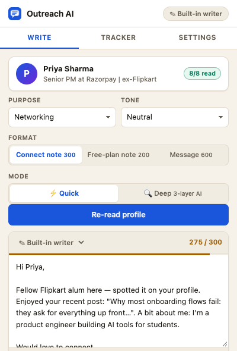
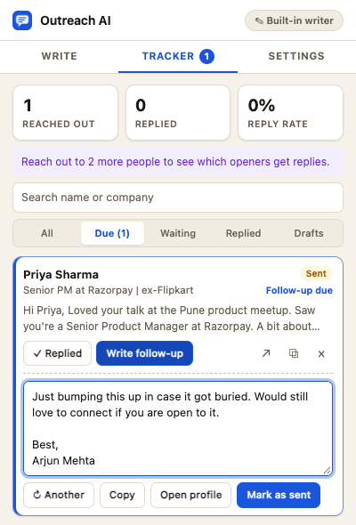
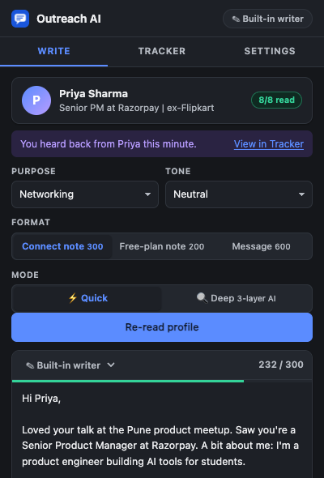

# LinkedIn Outreach AI — v3.3.0

Write a short, specific LinkedIn note from the profile you're viewing, built around what you actually have in common. Insert it into LinkedIn in one click, and get reminded to follow up if they don't reply.

| Write | Tracker | Dark mode |
|---|---|---|
|  |  |  |

## Install (2 minutes)
1. Unzip `dist/linkedin-outreach-ai-v3.3.0.zip` (or use the `extension/` folder directly).
2. Open `chrome://extensions`, switch on **Developer mode**, click **Load unpacked**, and select the folder.
3. Pin **LinkedIn Outreach AI**. Shortcut: `Alt+Shift+O`.

## Use
1. **Settings:** add your name, a one-liner and your background (companies, schools, skills, city). Upload your resume (PDF, kept on this device). Optionally add your Anthropic key for AI drafts and resume reading, and your OpenAI key for Deep Mode.
2. Open someone's profile and pick a mode:
   - **⚡ Quick** → **Read profile & draft**. The pill shows how much of the profile was read (e.g. `8/8 read`).
   - **🔍 Deep (3-layer AI)** → **Read + research**. **L1** (OpenAI) turns the page into clean data, checked against the page text. **L2** (OpenAI web search) finds recent company news and the person's own public work, with sources. **L3** writes the message from all of it. Each layer shows its real status.
3. Under **What to mention**, pick up to two hooks (★ = something you have in common) or add your own detail. Choose the format (300 / 200 / message) and the draft fits automatically.
4. On LinkedIn open **Connect → Add a note** or **Message**, reopen the extension (the draft is still there), then **Insert into LinkedIn** (`Ctrl/⌘+Enter`). Read it, then send.
5. **Tracker:** mark people Sent or Replied. When a follow-up is due you'll see a badge on the icon. **Write follow-up**, send it, then **Mark as sent**.
6. Like a draft? **☆ Save as template** and reuse it for anyone.

Without an API key everything runs locally, and nothing leaves your browser. Deep Mode needs your own OpenAI key.

## What's new
See **[docs/CHANGELOG.md](docs/CHANGELOG.md)**: the original audit, every change step by step, and why.
See **[docs/TESTING.md](docs/TESTING.md)**: 236 tests, the full scenario matrix, the bugs they found, and the 5-minute manual check for live LinkedIn.
See **[docs/ARCHITECTURE.md](docs/ARCHITECTURE.md)**: module map, data model, reliability, security and the scaling plan.

## Develop
```bash
npm ci
npm run check       # everything below (~95 s)
npm run lint        # ESLint
npm test            # 140 unit tests + coverage gate (100% lines)
npm run test:dom    # 26 content-script tests in real Chrome
npm run test:e2e    # 70 end-to-end steps in real Chrome + popup coverage gate (≥90%)
npm run test:fuzz   # 5,000-case property fuzzing (FUZZ_SEED=… to reproduce)
npm run package     # validates manifest → dist/linkedin-outreach-ai-v<version>.zip
# First time only: npm run setup:browsers   (downloads Playwright's Chromium, ~100 MB)
# Don't point CHROME_PATH at Google Chrome for e2e: Chrome 137+ refuses --load-extension.
```

```
extension/
  manifest.json
  background/   index · router · store · migrate · hooks · writer-local · writer-ai
                anthropic · openai · deep · templates · tracker · followups · linkedin
  content/      content_script.js   (all LinkedIn selectors in one SELECTORS block)
  popup/        popup.html · popup.css · main · write · tracker · settings · api · dom
  shared/       constants.js · text.js
tests/unit/     140 tests: *.test.mjs + helpers (fault-injecting chrome mock, fuzz PRNG, fixtures)
tests/dom/      26 content-script tests in real Chrome
tests/e2e/      harness · run (journey) · scenarios · ui-edges · deep · mock LinkedIn pages
scripts/        package · coverage-report · coverage-gaps · make_icons
docs/           CHANGELOG · TESTING · ARCHITECTURE · LOOM_OUTLINE
```

## Known limits
- LinkedIn changes its markup. If **Read** or **Insert** misbehaves, update `SELECTORS` in `content/content_script.js`; the read check will flag it.
- The character limits (300 / 200) match what LinkedIn has shown. At insert time the extension reads LinkedIn's real `maxlength` and warns if it's lower.
- The extension never presses Send, so "Sent" and "Replied" are marked by you.
